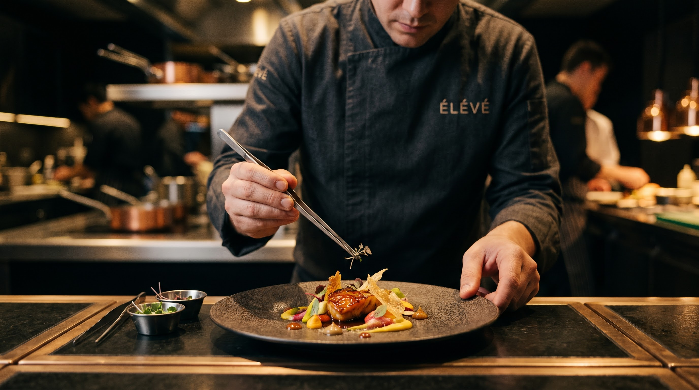

# ÉLÉVÉ — A Different Perspective on Fine Dining

A cinematic single-page experience for a fictional contemporary haute-cuisine
restaurant, built to the standard of an international luxury web agency.



## Stack

- **React 18 + TypeScript + Vite** — modern, typed, fast builds
- **Tailwind CSS** — design tokens for the brand palette and type scale
- **GSAP + ScrollTrigger** — scroll choreography: masked line reveals,
  clip-path image unveilings, multi-speed parallax, word-by-word statement
  illumination, full-bleed cinematic band expansion
- **Lenis** — inertial smooth scrolling, synced to GSAP's ticker
- **Framer Motion** — preloader, mobile menu, lightbox and form-state
  transitions

## Design system

| Token | Value |
| --- | --- |
| Ink (deep black) | `#090909` |
| Coal (secondary black) | `#141311` |
| Champagne gold | `#C5A46D` |
| Ivory | `#F0EBDD` |
| Warm grey | `#99948B` |
| Display serif | Cormorant Garamond |
| Sans | Jost |

## Sections

1. **Hero** — full-screen cinematic image, per-letter title reveal, parallax,
   animated scroll indicator
2. **The Experience** — asymmetric editorial collage + full-bleed ambience film
3. **Our Philosophy** — scroll-scrubbed word illumination, ghost numerals
4. **The Menu** — five editorial course spreads with a cinematic signature-dish
   interlude in motion
5. **The Chef** — large-format portrait, magazine-style biography, plating film
6. **Gallery** — editorial masonry with an accessible lightbox (keyboard
   navigation, focus-safe)
7. **Reservations** — fully working request form with pending / success /
   error states

## Reservations backend

The UI is production-ready and intentionally decoupled from any provider.
`src/lib/reservations.ts` is the single integration point — swap the body of
`submitReservation` for a real `fetch` to SevenRooms / OpenTable / a bespoke
API and nothing else changes. The interface copy is honest: submitting sends a
*request*; no table is presented as confirmed automatically.

## Craft details

- Custom cursor (fine-pointer devices only; native cursor kept for usability)
- Animated film-grain overlay, styled scrollbar, gold selection color
- Videos play only while in viewport (IntersectionObserver) and use posters
- `prefers-reduced-motion` respected: smooth scroll and grain disabled
- Lazy-loaded imagery, preloaded hero, semantic landmarks, labelled controls

## Development

```bash
npm install
npm run dev      # http://localhost:5173
npm run build    # typecheck + production bundle
npm run preview
```
